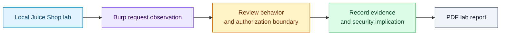

# Burp Suite Pentesting

A personal exploration into web vulnerability testing using **Burp Suite** against OWASP’s intentionally vulnerable Juice Shop web application. This project showcases experimentation with HTTP interception, request tampering, and various attack simulations, all aimed at learning core web security concepts.

## From a lab observation to a defensible finding

The deliverable is a PDF lab report, rather than an application or reusable attack framework. Its screenshots document observations in an intentionally vulnerable training environment.



Read [Burp Suite Pentesting.pdf](Burp%20Suite%20Pentesting.pdf) for the original evidence. JWT decoding reveals encoded fields; decoding alone does not verify a signature or decrypt the token. Reproductions should use a separate local training instance with synthetic data.

## Note

This was a hands-on practice project to better understand common web vulnerabilities and the use of Burp Suite’s key features. It is not intended for production or offensive security without permission.

## Features

* **Local Juice Shop Setup with Docker**: Deployed a local instance of OWASP Juice Shop for safe vulnerability testing.
* **HTTP Interception and Request Tampering**: Used **Repeater** and **Intercept** tools to manipulate HTTP requests and responses.
* **SQL Injection Simulation**: Demonstrated SQLi on login fields to bypass authentication.
* **User Enumeration**: Identified sensitive user data via HTTP responses.
* **Open Directory Discovery**: Detected exposed directories via HTTP History panel.
* **Basket ID Exploitation**: Performed **IDOR** (Insecure Direct Object Reference) attacks via basket enumeration.
* **JWT Token Decoding**: Inspected encoded token fields using the **Decoder** tool; signature verification is a separate check.
* **Negative Quantity Logic Flaws**: Simulated logic flaws using crafted requests.

## Stack

* **Burp Suite (Community Edition)**
* **Kali Linux**
* **OWASP Juice Shop (via Docker)**
* **Chromium Browser**

## Documentation

The PDF included in this repository provides step-by-step documentation of each test scenario, including screenshots and tools used. Ideal for beginners wanting to learn real-world attack simulations in a safe, ethical environment.

## Setup

1. Clone the repository:

   ```bash
   git clone https://github.com/C0deRhin0/juiceshop-penetration.git
   ```

2. Follow the steps in the documentation PDF to:

   * Install Docker
   * Deploy OWASP Juice Shop locally
   * Launch Burp Suite and begin testing

## Contribution

This is a personal learning project, but you're welcome to fork it and share your own scenarios or add insights.

1. Fork the repository.
2. Create a branch:

   ```bash
   git checkout -b new-test-scenario
   ```
3. Commit and push your changes.
4. Submit a pull request!

## License

This project is licensed under the [MIT License](LICENSE).

## Acknowledgments

* [OWASP Juice Shop](https://owasp.org/www-project-juice-shop/)
* [PortSwigger Burp Suite](https://portswigger.net/burp)

## Contact

* **Author**: C0deRhin0
* **GitHub**: [C0deRhin0](https://github.com/C0deRhin0)
